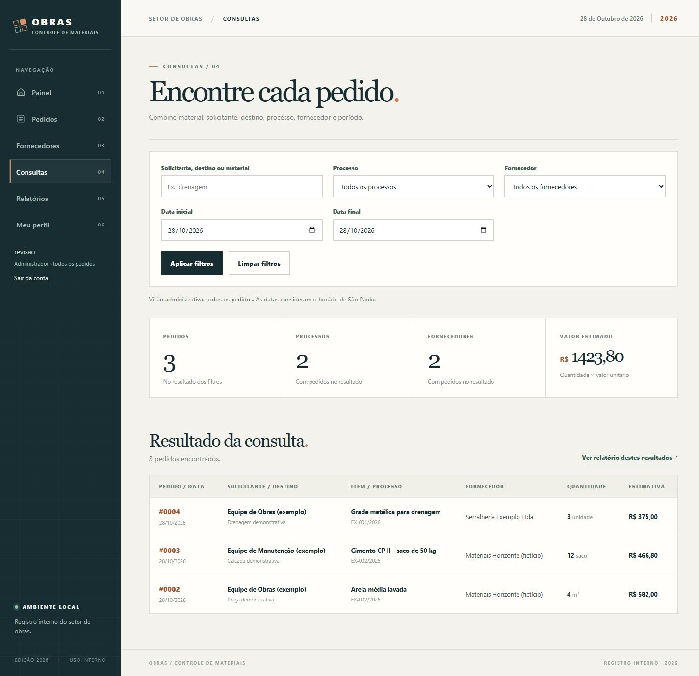
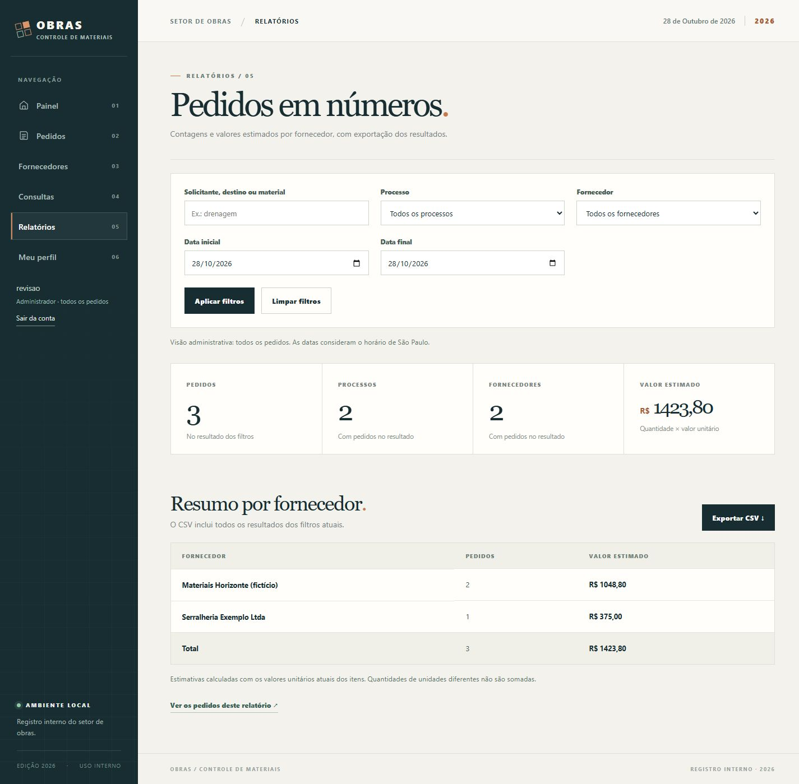
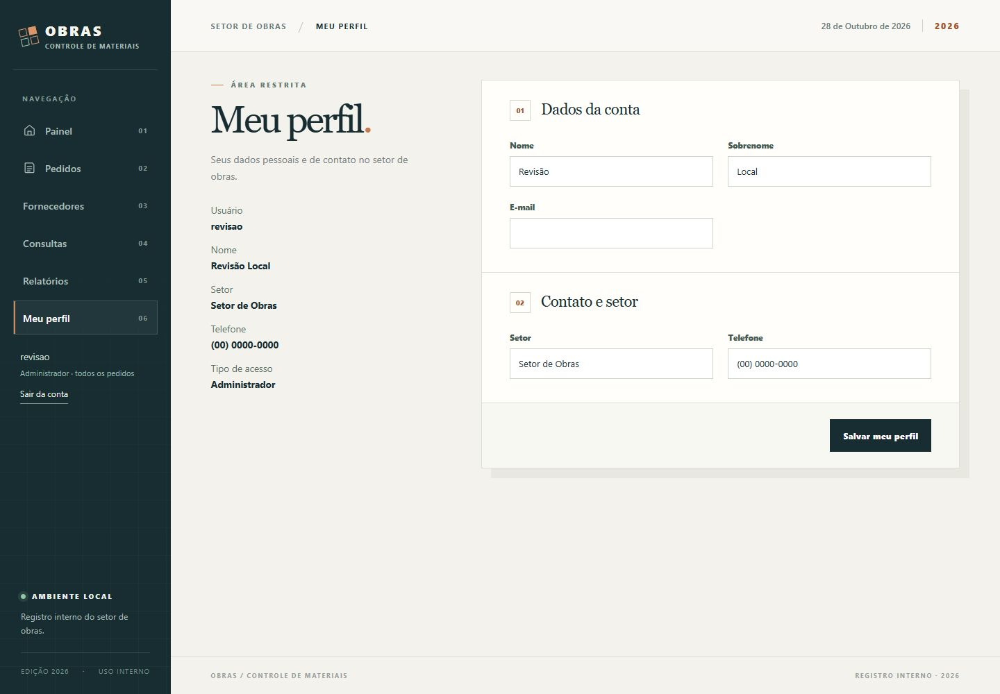
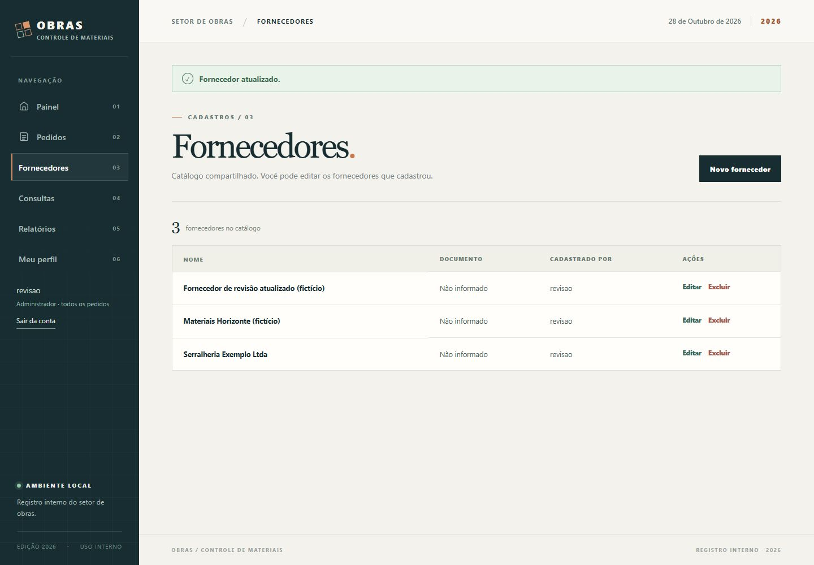

# Entrega da Semana 5

## Checklist

- [x] Tela de consultas separada da listagem de pedidos.
- [x] Buscar pedidos por solicitante, destino ou material.
- [x] Filtrar pedidos por processo, fornecedor e período.
- [x] Relatório com quantidade de pedidos e valor estimado por fornecedor.
- [x] Exportar o relatório em CSV com os filtros selecionados.
- [x] CRUD completo de fornecedores.
- [x] Login e área restrita.
- [x] Permissões por usuário para acessar e alterar pedidos.
- [x] Perfil do usuário com relação 1:1.
- [x] Relação N:N entre processos e fornecedores com `ItemLicitado` como `through`.
- [x] Dashboard e CRUD de pedidos das semanas anteriores mantidos.
- [x] 36 testes automatizados aprovados.

## Capturas da funcionalidade

As imagens abaixo mostram dados fictícios usados para demonstrar as consultas, os relatórios e os cadastros.

### Consulta de pedidos

A tela permite combinar os filtros e consultar os pedidos do período selecionado.

### Relatório por fornecedor

O relatório mostra os totais por fornecedor e a opção de exportar os resultados em CSV.

### Perfil do usuário

A tela exibe os dados do usuário e permite editar nome, e-mail, setor e telefone.

### Listagem de fornecedores

A lista mostra os fornecedores cadastrados e as ações de criar, editar e excluir.

